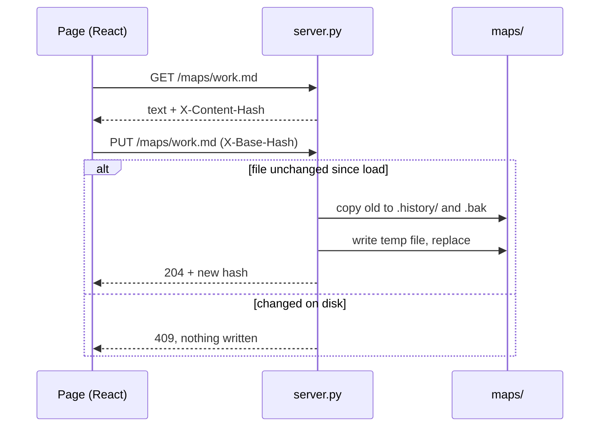
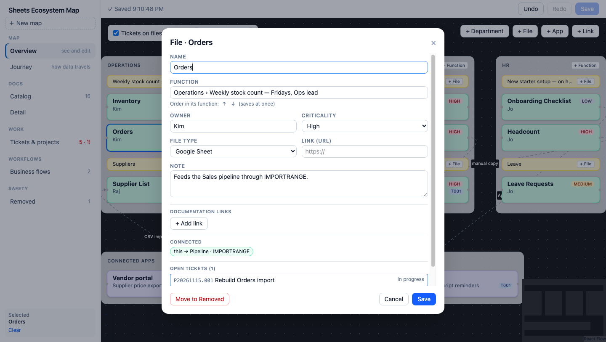

# Sheets map: React app design

**Goal.** Replace the hand-wired UI with a React app (Vite, Tailwind, React Flow) **without losing a single record**. The data stays in plain files in `maps/`; only the screen changes.

## Storage rules

The files are the database (see *Data file* in `GLOSSARY.md`). `server.py` is the only thing that writes, so every rule lives in one place and has tests.

| # | Rule | Where it is enforced |
|---|------|----------------------|
| 1 | Same formats: `.md`, `.flows.md`, `.tickets.json`. New fields are optional (e.g. an indented `Purpose:` line), so old files always load. | parsers in `app/src/lib/` |
| 2 | Every save first copies the old file to `maps/.history/<name>/` (last 20) and to `<name>.bak`. | `server.py`, `scripts/test_server.py` |
| 3 | A save carries the *base hash*. If the file changed on disk since it was loaded, the server answers 409 and writes nothing. The page then offers Reload or Overwrite (Overwrite still snapshots the other version). | same |
| 4 | Writes go to a temp file, then replace, so a crash never leaves half a file. | same |
| 5 | Explicit **Save** (⌘S) with an unsaved-changes marker and a leave-page warning. No autosave. A save refused with 409 shows *Reload* or *Overwrite*. A modal's own Save is the exception: it writes at once ([ADR 0002](adr/0002-modal-save-writes-to-disk.md)). | `Toolbar.jsx`, `lib/records.js`, `scripts/e2e-local.mjs` |
| 6 | Deleting never destroys: an entry goes to **Removed** with its links, and Restore puts it back exactly (every sheet, link and ticket has a permanent `sort` number). Only Purge deletes. Text the importer cannot model is kept word for word in `meta.legacy`. | `lib/ops.js`, `scripts/test-migration.mjs` |
| 7 | Every edit goes through one function that refuses a change which would make the file invalid, and keeps the previous copy for undo/redo. | `lib/records.js` |

## Editing on the map

The Overview map is where you work (there is no separate edit screen). Click a department, function, file, app or arrow to open its modal; use `+ Function` (on a department), `+ File` (on a function) and the top bar (`+ Department`, `+ File`, `+ App`, `+ Link`) to add; drag from the edge of one card to another to link. Modals live in `components/modals/`; `lib/records.js` `commit()` applies an edit and writes the file, returning the error or the 409 to the modal. A file's function is chosen in one type-to-filter box (`lib/pick.js`). **New map** asks only for a title; the file name is made from it (`slugFromTitle`). Moving a file between functions or reordering is done in its modal, not by dragging cards.

## Tickets board

`views/Work.jsx` + `components/TicketBoard.jsx`; pure helpers in `lib/board.js`. Board (drag a card onto a column to change its status; Blocked asks why first, any other status clears the reason) or Table (grouped by department), a summary strip with the blocked tickets, cards sorted by priority (file order breaks ties), project progress, and `+ Add` per column. Title, status, priority, owner and blocked reason edit in place; each change is one undo step and needs Save. The full form is still there for the rest (click the ID or the card body). The Board/Table choice is remembered in `localStorage` only.

## Departments, functions and files

Department → Function → Sheet, all optional additions to the Data file (an older file loads unchanged and `upgrade()` adds nothing):

| Level | Fields |
|---|---|
| Department | `text` (description), `members: [{ id, name, role, email? }]` |
| Function (stored as `sections`) | `title`, `note` (description) |
| Sheet | `type` (absent = Google Sheet; `doc`, `excel`, `pdf`, `other`), `docs: [{ label, url }]` |

Owners stay plain text; the pick-list offers the department's members. A department with members cannot be deleted. "Current tickets" are derived (Tickets whose Target is the file and whose status is not done), see `lib/rollup.js`. "Export as legacy files" can write the new fields as readable lines with `exportLegacy(data, { withNewFields: true })`; the app's own copy never does.

## The gate: nothing is lost

`npm run verify` (read-only) must pass before any migration step:

1. The new ES-module parsers (`app/src/lib/`) give byte-identical results to the original `js/` parsers on **every** file in `maps/`, private ones included.
2. Every old file round-trips parse → write with no data lost.
3. Every map imports into a Data file and exports back to the old formats with nothing lost, the same result every run.
4. Edit tests: remove/restore is exact for every order (exhaustive cases and 2000 random sequences), edits keep the file valid, renames never break links.
5. `server.py` storage tests (history, 409, force, size, origin, data-file shape).

`npm run e2e` drives the real app in Chrome on throwaway sandboxes: import, edit, save, undo, delete, restore and conflict (`e2e-local`); a whole map built from an empty folder with no legacy file (`e2e-from-scratch`); and opening a file from an earlier build (`e2e-upgrade`).
CI can only run the gate on the `demo.*` files; run it locally before each commit.

## Layout

`app/` Vite + React 19 + Tailwind v4 + React Flow. Left rail: Overview (canvas + layers), Journey, Catalog, Detail, Tickets & projects, Business flows. Build: `app/dist`. **One port for use:** `./start.command` builds `app/dist` when it is missing or older than `app/src`, and `server.py` serves it at `/` (assets at `/assets/`) on port 8000; the old page stays at `/legacy/` until the switch-over. The launcher replaces any server already on the port. Dev only: `cd app && npm run dev` (a second port, with hot reload; proxies `/maps`, `/data`, `/api` to `server.py`). `npm run e2e` builds and tests the one-port setup (`E2E_DEV=1` uses Vite).

## Migration order

1. **Done:** read-only app on the real records; storage hardening; verify gate; the Data file format with import and legacy export; Save, undo/redo, conflict handling; Removed with exact restore; **create a map from nothing and add, edit, move and delete every kind of entry** (departments, sections, sheets, apps, links, tickets with time log, flows and steps) without any legacy file or the old app.
2. Next: Backup button, search (`⌘K`), shared filters on every list, the three Exports, Export as legacy files, a table view of tickets.
3. When parity is reached and the switch-over rule below is met: serve `app/dist` at `/`, then delete the old `index.html`, `js/` and `css/`.
4. Never touched at any step: the old files in `maps/` and every `.bak`.

## Decided (storage format round)

See [ADR 0001](adr/0001-one-json-data-file-per-map.md). In short:

- One JSON Data file per map in `data/`; entries have permanent IDs (links point at IDs, names are labels); `schemaVersion` in every file.
- A Data file written by an earlier build is brought up to date in memory when opened (`upgrade` in `schema.js`: it only fills in missing sort numbers); the file on disk changes only when you press Save, which snapshots the old one first.
- One-time, re-runnable import from the old files, which are never modified. `npm run verify` proves import → export-as-legacy-files matches every old file.
- Deleting moves an Entry to **Removed** (restorable until purged), on top of Snapshots.
- Off-disk **Backup** button to a folder you choose, with a reminder after 7 days.
- Exports (map document, ticket report, flow document with Mermaid) are buttons in the app that download `.md`.
- Build order: undo/redo + Removed, global search (`⌘K`), shared filters, export buttons.
- Switch-over: editors ported, `npm run verify` passes on real files, a week of normal use; then the old app and old files stay 30 more days; only the old UI code is deleted, never old data.

## Not decided yet

- Whether Catalog and Detail both stay in the rail (both stay for now).
- The "What it is for" field: stored as `Purpose:` (rule 1) once the map form is ported.
