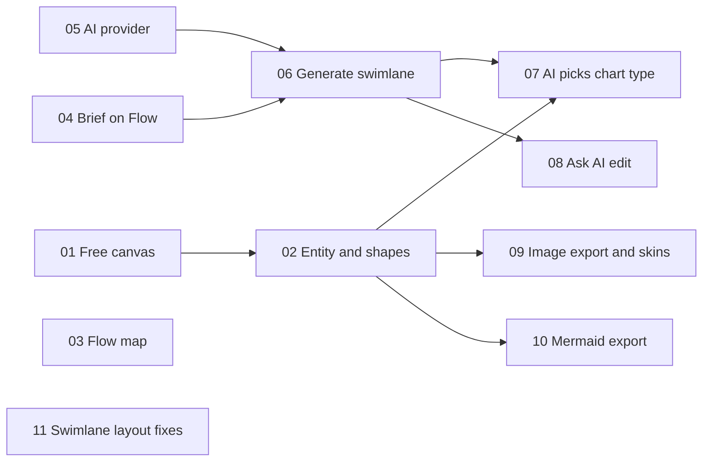

# Plan: Business flow canvas and AI flows

Status: Phases 1 to 3 built on branch `feat/flow-canvas-editing` (see their notes below). Phases 4 to 7 are planned as tickets in `.scratch/flow-ai/issues/` (01 to 11); all tickets 01 to 12 are built (free canvas and shapes, Flow map, brief, AI provider, Generate with chart types, Ask AI on swimlanes and free canvases, skins and image export, Mermaid export, swimlane fixes) on branch `feat/ai-flows`, the rest not started. Scope is the React app (`app/`) only. The legacy vanilla app is frozen.

## Goal

Make Business flows simple to build, flexible to note, and clear as a diagram:

1. The canvas is the editor (drag, type on the diagram, draw arrows), like a drawing tool.
2. Notes are free text, with sticky notes anywhere.
3. The diagram explains the process: start/end, decisions with labelled branches, labelled hand-offs.
4. The diagram can be shared as PNG/SVG (Mermaid export stays).
5. The user writes a brief (and optionally a rough draft of the steps); AI suggests a chart that suits it (swimlane, flowchart, waterfall or entity) and later edits it on request.
6. Simple PowerPoint-like shapes on a free canvas: rectangle, rounded, pill, diamond, entity box, note and labelled arrows.
7. Flows connect to each other and can be seen together on a Flow map.

## Rules that apply to every phase

- **Additive only.** New fields are optional. Old flows and `data/*.json` load unchanged. Bump `schemaVersion` only if `upgrade()` cannot fill the gap in memory.
- **The data file changes only on Save**, after a snapshot. Never overwrite `data/*.json`.
- **Every canvas action goes through `apply` / undo / redo.** Deletes go to **Removed** and restore exactly. New entries get a permanent `sort`.
- **Shared language** follows `GLOSSARY.md` (Team, Hand-off, Function, Entry, Data file). Add **Note**, **Decision** and **Brief** to it when they land.
- Tests: extend the existing round-trip and 2000-sequence delete/restore tests to cover each new field.

## Facts the plan rests on

- Flow canvas today: `src/views/Flows.jsx` + `buildFlow` in `src/graph.js`. Steps are `draggable: false`; positions come from dependency depth. Editing is the 400px form `components/FlowEdit.jsx`.
- Flow data (`lib/schema.js`): `flows[{ id, title, every, teams, steps[{ id, team, title, day, sheetId|sheetName, ticket, note, triggers, backs }] }]`. Ops in `lib/ops.js`: `addFlow`, `updateFlow`, `addStep`, `updateStep`, `shiftStep`, `removeStep`.
- Department description is `text[]`; Function description is `section.note`. These are the AI input.
- There is no AI in the app. `server.py` only reads and writes `data/*.json`.

## Build order

Phases 1 to 3 are done. The rest, by ticket (numbers are files in `.scratch/flow-ai/issues/`):

**Suggested order:** 05, 04, 06 first, so "brief in, suggested swimlane out" works within three tickets. Then 01 and 02, then 07 and 08. Tickets 03, 09, 10 and 11 can go in at any time.

## Phase 1: Edit on the canvas

- Double-click a step to type its text inline. Delete removes it (to Removed).
- Drag a step to another lane: sets `team`. Horizontal position stays automatic and snapped. Drag within a lane reorders (`shiftStep`).
- Draw an arrow by dragging from a step's right handle to another step: adds a `trigger` (later step) or a `back` (earlier step). Select an arrow to change its message or delete it.
- Double-click an empty lane spot to make a step in that team. Enter after typing makes the next step, already triggered by the previous one. Esc stops.
- Paste several lines to make several steps; the team defaults to the previous step's team.
- Rename, reorder and add lanes directly on the canvas.
- The side form shrinks to a details panel (day, sheet, ticket, note) that opens on select.
- Done when: a whole flow can be built and rearranged without opening the form, and every action undoes.
- **Built (phase 1):** inline retype, drag between lanes (hot-lane highlight), draw arrows by dropping anywhere on the target step, Delete for steps and arrows, double-click-to-add with Enter chaining, multi-line paste, lane add/rename/reorder/remove, details panel for the selected step only. Tests: `scripts/test-flow-edit.mjs`, `scripts/e2e-flow-canvas.mjs`.
- **Not done, on purpose:** dragging a step sideways within its lane does not reorder it. A step's column comes from its arrows, and reordering by hand would silently break "waits on an earlier step". Reorder still uses the details panel's up/down. Decide with the user whether to add this.
- **Found on the way:** every canvas in the app turns black on a dark-mode OS (React Flow follows the system theme while the rest of the app is light-only). Not caused by this work; the Blueprint skin in Phase 4 is the place to settle it.

## Phase 2: Notes

- Add optional `note` to the flow (the existing step `note` stays).
- New **Note** Entry: `{ id, sort, text, x, y, attachedStepId? }` stored on the flow (`flow.notes`). Free-floating or attached to a step with a thin line. Double-click to edit. Delete goes to Removed.
- Notes are drawn on the diagram and exported to Markdown/Mermaid as comments.
- Done when: notes survive Save, reload, undo, Removed/restore, and legacy round-trip.
- **Built (phase 2):** `flow.note` (shown above the diagram, edited in the details panel) and `flow.notes[{ id, sort, text, x, y, stepId? }]`. A pinned note's x,y are an offset from its step, so it follows the step; a free note's are canvas coordinates. Add from a step's "+ Note", the header "+ Note" button, or by double-clicking empty canvas. Double-click edits (Ctrl/Cmd+Enter or leaving the box saves, Esc drops the change), drag moves, Delete sends it to Removed, and a note typed but left empty is never created. If a pinned note's step is deleted the note stays (drawn dashed) and re-pins when the step is restored. The Markdown legacy export is unchanged; the "new fields" export writes notes as `<!-- Note: ... -->` comments the old parser skips. Tests: `scripts/test-flow-notes.mjs`, `scripts/e2e-flow-notes.mjs`.
- **Not done:** Mermaid export of notes, because the Mermaid flow export does not exist yet (Phase 4). Un-pinning or re-pinning an existing note is not possible; delete and re-add.

## Phase 3: Start, end and decisions

- Optional step `kind`: `step` (default) | `start` | `end` | `decision`. A decision draws as a diamond; its outgoing arrows use the existing trigger message as the branch label (Yes/No). The existing send-back arrows stay dashed red.
- Start/end draw as pills. A flow with no start/end looks exactly as today.
- Update `flows-parser.js` / export only where needed so the Markdown and Mermaid exports show the new kinds, and the legacy import still works.
- Done when: the Quote approval demo can be redrawn with a start, a decision and an end, and old flows are unchanged.
- **Built (phase 3):** optional step `kind` (`start`, `end`, `decision`; absent means an ordinary step), set from a "Shape" field in the step details. Start/end draw as pills and a decision as a diamond. The first two arrows out of a decision are labelled Yes and No, both when drawn and when made with "+ Next". Clicking an arrow now opens its details to edit the message (a "Branch label" for a decision) or delete it, which also finished the phase 1 item about selecting arrows. The canvas reads `kind` from the Data file, because the old Markdown format has no place for it; the legacy export is unchanged and the new-fields export names shapes in comment lines. Tests: `scripts/test-flow-shapes.mjs`, `scripts/e2e-flow-shapes.mjs`.
- **Known limit:** two branches out of a decision that land in the same lane sit in one row, so the first branch's arrow (and its label) run behind the second box. Different lanes look right. Worth a layout fix (stack same-lane branches) as a follow-up.

## Decisions for phases 4 to 7

Settled with the user:
- **Shapes** are simple and PowerPoint-like: rectangle (resize for a square), rounded, pill, diamond, entity box, note, and arrows as labelled connectors. Block arrows wait until needed.
- **AI provider** is Claude or DeepSeek, chosen in a local gitignored config file. Only that provider is ever called.
- **Flows connect** to each other, and the connected Flows can be seen as one map.

Recommended by the assistant and confirmed by the user ("yes"):
- **Two layouts** (tickets 01, 07). A Flow has an optional `layout`: `swimlane` (default; today's behaviour) or `free`. On the free canvas each shape keeps its own position and size and there are no lanes; a Team lane is just a rectangle the user draws. Every later feature must work in both, so the free canvas stays small.
- **Shapes are steps** (ticket 01). A free-canvas shape is a Flow step with position, size and a shape added, not a new kind of Entry. Generate, Ask AI, notes and Flow connections then treat both layouts the same way. An entity box is a step with shape `entity`.
- **The free canvas reads the Data file** (ticket 01). The swimlane canvas draws from flows rebuilt from the old Markdown format, which cannot hold positions. The free canvas must draw straight from the Data file, as phase 3 already does for `kind`.
- **Switching layout** (ticket 01). Swimlane to free canvas only: it copies the current on-screen positions. There is no way back, because hand placement cannot be turned back into lanes and columns without losing it.
- **The app lays out, not the AI** (ticket 07). The AI returns the steps, arrows, notes and a chart type with a one-line reason. The app computes positions for that chart type. Changing the type in the preview is instant and needs no second AI call.
- **Chart types** (ticket 07). Swimlane (lanes per Team), flowchart (one column, no lanes), waterfall (stages in a staircase, each starting when the previous one ends; not the financial bar chart), and entity (boxes and relationships). Anything else falls back to the closest of the four, and the reason says so.
- **One brief, one Flow** (ticket 06). Generating several connected Flows from one brief is left for later.

## Phase 4: Free canvas and shapes (tickets 01, 02)

- Optional Flow `layout`; on `free`, steps carry `x`, `y`, `w`, `h` and `shape` (`rect`, `rounded`, `pill`, `diamond`, `entity`). Start/end/decision keep working and map to pill and diamond.
- Drag, resize, type inside, labelled arrows, notes; everything through apply/undo/Removed.
- Entity box: bold title, free description lines, optional Sheet reference. A relationship is a labelled arrow with text such as "1 to many"; no field types or keys.
- Done when: an entity diagram and a waterfall can be drawn by hand, saved, reloaded and undone, and old flows are unchanged.
- **Built (tickets 01 and 02):** optional flow `layout` (`swimlane` default, `free`) and, on a free flow, each step also has `x`, `y`, `w`, `h` and `shape` (`rect`, `rounded`, `pill`, `diamond`, `entity`). A swimlane flow is switched with **Switch to free canvas** (after a warning; one way; Undo works until Save): every step keeps its place on screen, every arrow it drew (the automatic ones and the "from a team" ones too) becomes an explicit arrow, and the lanes go away. The free canvas is drawn straight from the Data file (`app/src/free-graph.js`, `FreeCanvas.jsx`). It supports: double-click empty space for a rounded box; a header palette (rectangle, rounded box, pill, diamond, entity, note); drag to move; drag the handles of a selected box to resize; drag from a dot on a box's edge to another box to draw an arrow in either direction (`connectFree`), click an arrow to label or delete it; Delete sends boxes, arrows and notes to Removed; everything undoes. A diamond is a decision (its first two arrows are labelled Yes and No); start and end markers draw as coloured pills. An **entity box** is a step whose title is the name, whose note holds the description lines (double-click the body to edit them) and whose sheet is an optional reference shown as a tag; a relationship is a labelled arrow such as "1 to many". Sticky notes work as on a swimlane (free or pinned, draggable, editable). The new-fields Markdown export names the shapes of a free flow; the default export is unchanged and still lists every box. Tests: `scripts/test-flow-free.mjs`, `scripts/e2e-flow-free.mjs`, `scripts/e2e-flow-free-shapes.mjs`. Screenshots: `docs/screenshots/flow-free-switched.png`, `docs/screenshots/flow-free-shapes.png`.
- **Known limits:** a free flow has no lanes, so a box's team is just `General` in the file; an arrow to an "earlier" box is an ordinary arrow here, so in the old Markdown export arrows that point at later boxes are dropped with a warning; there is no way back to lanes.

## Phase 5: AI flows (tickets 04, 05, 06, 07, 08)

**Input.** The Flow's **brief** (what the process is for, who is involved, what goes wrong today) and an optional rough **draft** of the steps, both saved on the Flow so the user can edit them and generate again. Department and Function descriptions are optional extra context.

**Server.** Add to `server.py`:
- `POST /api/ai/flow` with `{ mapId, flowId?, instruction? }`; `GET /api/ai/status` returns only whether AI is on and the provider name.
- Config in a local gitignored file (for example `data/.ai.json`: `{ "provider": "claude" | "deepseek", "apiKey", "model" }`). The key is never sent to the browser or logged. DeepSeek uses its OpenAI-style chat API; check its current model names at build time.
- A length limit on the brief and draft keeps the cost of each request bounded.
- Tests use a local stub provider, so no test calls a real AI or needs a key.

**What is sent.** The brief, the draft, the relevant Department and Function descriptions, the current Flow (for edits), and the names of sheets and apps on the map (for matching). Not sent: member emails, tickets, time logs, other maps. The first time the user generates, a notice names the provider and says that this text leaves the computer for that provider's servers.

**What comes back.** Steps, arrows, notes and a chart type with a reason, validated against `schema.js` before the browser sees it. Invalid output means an error and no change. Unknown sheet names are kept as plain text and flagged; the AI never creates sheets. Assumptions and open questions arrive as notes, not guesses.

**UI.**
- "Generate" on a Flow with a brief. A preview shows the chart type and reason, with an override dropdown. Accept applies through apply/undo; Discard drops it. Nothing is saved until Save.
- "Ask AI" on an existing Flow: type a change, see a preview with new shapes highlighted, removed ones struck through and changed text marked.
- No key: buttons disabled with a short hint. API failure: Flow untouched, reason shown. The provider name shows on the button and in the preview.

**Built (ticket 05):** `ai.py` and `server.py` read `data/.ai.json` and answer `GET /api/ai/status` and `POST /api/ai/test`; dot-files in `data/` are never served, listed or written; the Business flows header has an **AI** button that opens a panel with the provider's name, the privacy notice and Test connection. Setup guide: `docs/AI.md`; decision: `docs/adr/0003-ai-calls-only-from-the-server.md`. Tests: `scripts/test_ai.py`, `scripts/e2e-ai-setup.mjs`, with a fake provider in `scripts/lib/ai_stub.py`. DeepSeek thinking mode is turned off for these calls and is untested against the live service.

**Built (ticket 04):** optional `brief` and `draft` text on a Flow, typed in a "Describe your case" card at the top of the Flow details (8000 characters each), saved with Save, undoable, and written as `Brief:` and `Draft:` comment lines by the new-fields export. Tests: `scripts/test-flow-notes.mjs`, `scripts/e2e-flow-brief.mjs`. The "New flow" box still only asks for a name; the details panel opens straight after creating one, so the brief is the first thing to fill in.

**Built (ticket 06):** a **Generate flow** button in the Describe your case card, for an empty flow only. `POST /api/ai/flow` (`ai_flow.py`) builds the request from the brief, the draft, Department and Function descriptions and sheet and app names, strips emails and ticket ids, and checks the answer (valid JSON, at most 40 steps and 12 teams, arrows only to earlier steps, sheets matched by name, unknown ones kept as text and flagged). The page draws a read-only preview with the chart type and reason, and Accept applies it in one `apply` (one Undo). The AI always answers `swimlane` for now; ticket 07 adds the other chart types. Tests: `scripts/test_ai_flow.py`, `scripts/test-ai-flow.mjs`, `scripts/e2e-ai-generate.mjs`. Screenshot: `docs/screenshots/ai-generate-preview.png`.

**Built (ticket 08):** an **Ask AI** card on a flow that has steps. The page sends the words on the flow (with the arrows spelled out the way the diagram draws them, no tickets) and the request; the AI returns the whole flow with a `was` number on each step it keeps. `applyEdit` keeps those steps' ids, tickets and sheets, changes only the words that differ, adds new steps where the AI put them, sends dropped steps to Removed and adds new notes (existing notes and "sent back" arrows are never touched). The preview marks new, changed and removed steps and lists the changes in words; Accept is one `apply`. A field the AI leaves out, or a copy with `[email removed]` in it, means unchanged. Tests: `scripts/test_ai_flow.py`, `scripts/test-ai-flow.mjs`, `scripts/e2e-ai-edit.mjs`. Screenshot: `docs/screenshots/ai-ask-preview.png`. Swimlane only; ticket 07 adds the other chart types.\n\n**Built (ticket 07):** Generate now lets the AI choose a chart type (`swimlane`, `flowchart`, `waterfall` or `entity`) with a one-line reason. For an entity answer each step is an entity (name, up to 8 description lines, optional sheet) and the "waits" are labelled relationships. The app, not the AI, places the boxes (`app/src/lib/auto-layout.js`): a flowchart is rows by rank from the top, a waterfall steps right and down, an entity diagram is columns by rank from the left; no two boxes overlap. The preview has a **Chart type** dropdown that redraws at once without asking the AI again (a process answer: swimlane, flowchart, waterfall; an entity answer: entity only; a free flow has no swimlane option). Any chart other than a swimlane turns the empty flow into a free canvas (one way, said in the preview); Accept is one `apply`, so one Undo also undoes the switch. Tests: `scripts/test_ai_flow.py`, `scripts/test-ai-flow.mjs`, `scripts/e2e-ai-chart.mjs`. Screenshot: `docs/screenshots/ai-chart-entity.png`. Ask AI on a free canvas is ticket 12 (done).\n\nDone when: a brief produces a valid Flow in a sensible chart type, an Ask AI edit previews and applies with undo, and a missing key or a bad response leaves the data untouched.

## Phase 6: Flow map (ticket 03)

- New **Flow connection** Entry: Flow A leads to Flow B, with an optional label and an optional starting step in A. Not called a Link, which is a data flow between Sheets.
- A Flow map view under Business flows draws each Flow as a box and each connection as an arrow; clicking a box opens the Flow. Box colour comes from the Department of the Flow's first Team, or a neutral colour when that Team is not a Department.
- Deleting a connection sends it to Removed. Deleting a Flow sends its connections with it, and restoring the Flow brings them back.

## Phase 6 built (ticket 03) and ticket 12

- **Built (ticket 03):** an optional list `flowLinks: [{ id, sort, fromFlowId, toFlowId, label, fromStepId? }]` in the Data file (absent = none; old files load unchanged) and a **Flow map** view in the left list under Business flows (`FlowMap.jsx`, layout in `lib/flow-map.js`, not stored). Each flow is a box showing its size and the Department of its first team (grey when that team is not a Department); drag from a flow's right dot to another flow to connect them; click an arrow to label it, pick a starting step or delete it; Delete removes a selected arrow; double-click a flow, or **Open this flow**, to go to it. Deleting a connection sends it to Removed (as a "Flow connection" named after its two flows); deleting a flow takes its connections with it, as a bundle like a sheet's links, and restoring the flow brings them back (a connection waits with the second flow when both are removed); purging a flow forgets them. A flow cannot lead to itself and the same pair can be connected again only from a different starting step. The all-flows document starts with a Mermaid diagram of how the flows connect. Tests: `scripts/test-flow-links.mjs`, `scripts/e2e-flow-map.mjs`. Screenshot: `docs/screenshots/flow-map.png`.
- **Built (ticket 12):** Ask AI works on a free canvas. The AI is told the flow is a free canvas (no lanes, arrows in any direction, entity lines), `applyEdit` keeps kept boxes exactly (place, size, shape, sheet, backward arrows), places new boxes beside the box they connect to without overlapping anything (`freeSpot` in `auto-layout.js`; an entity box when the diagram is all entities), and the preview marks NEW, CHANGED and REMOVED boxes on the canvas. Tests: `scripts/test-ai-flow.mjs`, `scripts/test_ai_flow.py`, `scripts/e2e-ai-edit-free.mjs`.

## Phase 7: Share and polish (tickets 09, 10, 11)

- **Built (ticket 09):** three **skins** (Paper, Blueprint, Marker): colour, line weight, corner radius and font tokens in `app/src/lib/skins.js`, applied on screen through CSS variables on the canvas and used by the exporter, so an exported image matches what you see. The choice is a per-viewer convenience kept in this browser (not in the Data file; a skin never changes data). **Export PNG** and **Export SVG** draw the diagram (lanes, every shape, arrows with labels, notes) straight from the graph in `app/src/lib/export-image.js`, for swimlanes and free canvases alike; the PNG is drawn at twice the size. It also fixes the canvas turning black on a dark-mode computer: this version of React Flow follows the system theme unless told otherwise, so every canvas now forces light mode (Blueprint forces dark). Tests: `scripts/test-flow-export.mjs`, `scripts/e2e-flow-export.mjs` (with the computer set to dark mode). Screenshot: `docs/screenshots/flow-skin-blueprint.png`. Marker is included in the first release. Known: tags inside boxes (sheet, day, ticket) keep fixed colours in every skin.
- **Built (ticket 10):** **Export Mermaid** (this flow) and **All flows (.md)** download Markdown with a Mermaid diagram per flow (`app/src/lib/flow-mermaid.js`). A swimlane is a left-to-right flowchart with a subgraph per lane, decision diamonds, start and end pills, Yes/No and message labels, and dashed "sent back" arrows. A free canvas is a top-down flowchart (Mermaid places the boxes itself, so positions are not kept; the document says so). A free canvas of only entity boxes becomes an ER diagram with fields and cardinalities read from labels such as "1 to many" (field names are transliterated to ASCII because Mermaid refuses accents; the real text is kept as a comment). Sticky notes are comments in the diagram and a list under it. An Export is never read back. Tests: `scripts/test-flow-mermaid.mjs`; `scripts/check-mermaid.mjs` feeds sample output to the real Mermaid parser (needs a network, so it is not in `npm run verify`); it caught the accent problem.
- **Built (ticket 11):** two or more branches of one step that land in the same lane are stacked in that lane (the lane grows), so no arrow or label hides behind another box; unrelated steps that want the same place still go one column along, and lanes without stacking keep their usual height. **Decided:** dragging a step sideways inside its lane will not reorder it, because a step's column comes from its arrows and hand reordering would silently break "waits on an earlier step"; use the free canvas to place boxes by hand, or the up/down buttons in the details to reorder. Tests: `scripts/test-flow-layout.mjs`.

## Open items

- Generating several connected Flows from one brief.
- Glossary terms to add when they land: Note, Decision, Brief, Layout, Shape, Flow connection, Flow map. (`GLOSSARY.md` is the user's own file; ask before committing it.)
